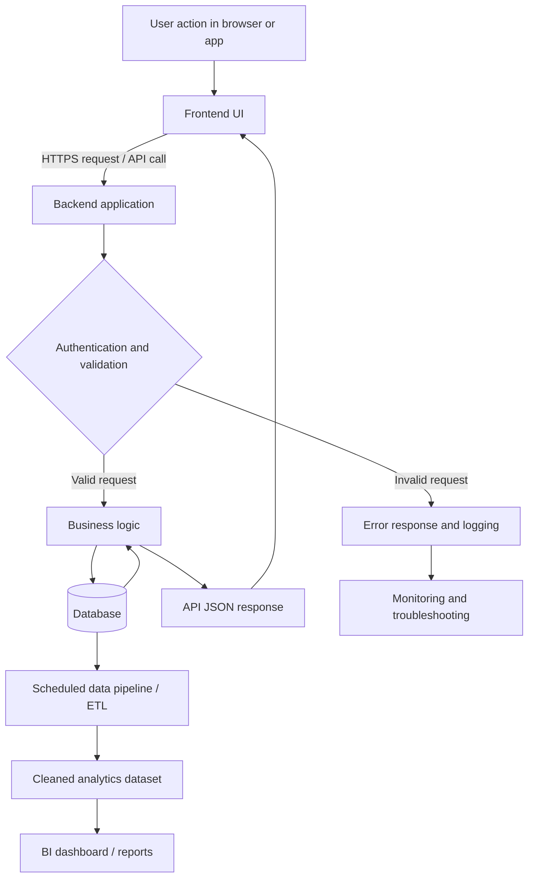

# Software Architecture — Data Flow Diagram

## Diagram

## Explanation
1. A user clicks, submits a form or opens a page in the frontend.
2. The frontend sends a request to the backend using an API.
3. The backend checks authentication and validates the request.
4. Business logic reads or writes the database.
5. The backend returns a response, often JSON, to the frontend.
6. A separate authorized data pipeline extracts data, cleans it and loads an analytics dataset.
7. A dashboard tool reads the curated dataset and displays KPIs, trends and charts.
8. Errors should be logged with enough context to investigate, without exposing passwords, tokens or sensitive user data.

## Key terms
- **Frontend:** user-facing interface.
- **Backend:** server-side code and business rules.
- **Client–server:** a client requests a service; a server responds.
- **Database:** organized persistent data store.
- **Data pipeline / ETL:** extract, transform and load data.
- **Logging:** recording events and errors for troubleshooting.
- **SDLC:** requirements, design, development, testing, deployment and maintenance.

## Analyst's perspective
An analyst should understand the meaning of fields, data refresh timing, source tables, validation rules, missing values and the effect of failures on dashboard metrics.
